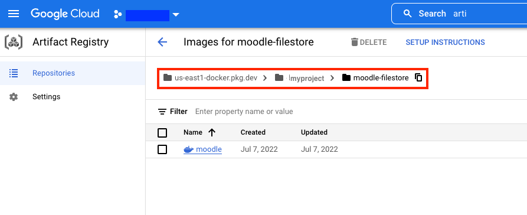
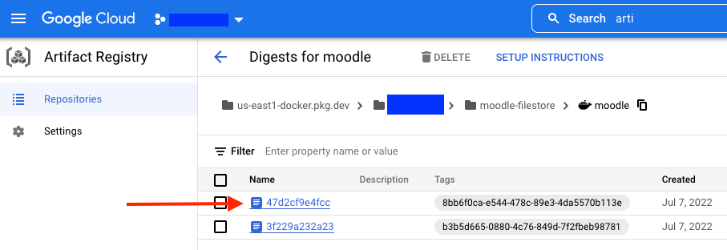

# Building Moodle's container image

This step will set up a Cloud Build in Google Cloud to generate a new container image for Moodle. For that, edit the information available in [cloudbuild-nginx.yaml](../4-moodle-image-builder/cloudbuild-nginx.yaml) and use the shell script [build-nginx-based-image.sh](../4-moodle-image-builder/build-nginx-based-image.sh) located in the [4-moodle-image-builder](../4-moodle-image-builder/) directory.

Key highlights of the NGINX-based Moodle image:
  - Adjusted performance tuning on NGINX, PHP-FPM, OPcache, and PHP JIT.
  - Lighter HTTP server footprint with NGINX.
  - No need for pod-level SSL since TLS termination is handled at the Google Cloud Load Balancer / Ingress.
  - Automated self-installation on first run:
    - Configures cron and background tasks inside the container.
    - Bundles the `moosh` utility for CLI admin operations.
    - Uses `moosh` to install recommended plugins (`tool_opcache`, `report_benchmark`, and `local_redislock` when Redis locking is enabled).
    - Configures default recommended settings in `config.php` (Redis for Session, Application Store, and File Locking).
    - Tested with 200K+ concurrent users alongside Redis Enterprise / Google Cloud Memorystore for Redis.
    - Supports separate Redis instances for application store, session handling, and file locks.

1. First, under `steps` in `cloudbuild-nginx.yaml`, update the `args` line with your container registry details. We recommend using `moodle-nginx` as the image name:

Change:
```
'$LOCATION-docker.pkg.dev/$PROJECT_ID/moodle-filestore/moodle-nginx:$BUILD_ID',
```
to your desired repository/image name if customized:
```
'$LOCATION-docker.pkg.dev/$PROJECT_ID/moodle-filestore/my-nginx-moodle-image:$BUILD_ID',
```

If you're using Google Cloud Artifact Registry (like the example below), that information is available in the service's console page, as depicted below.

<p align="center">
    
</p>

If you're using another container image repository, collect the connection information and make sure it is accessible by your GKE cluster.

For Artifact Registry, the build step looks like this:
```
args: ['build', '-t', '$LOCATION-docker.pkg.dev/$PROJECT_ID/moodle-filestore/moodle-nginx:$BUILD_ID', '.', '-f', 'Dockerfile.nginx']
```

2. Ensure the same image URI is configured in the `push` step inside `cloudbuild-nginx.yaml`:

```
args: [
    'push',
    '$LOCATION-docker.pkg.dev/$PROJECT_ID/moodle-filestore/moodle-nginx:$BUILD_ID'
  ]
```

3. Finally, kick off the `build` and `push` process via `0-infra/infra-creation.sh` or directly by running:

```
cd ../4-moodle-image-builder && ./build-nginx-based-image.sh
```

Wait until you get confirmation from the command line that the process finished successfully. Additionally, you can head to your image repository and double-check that the image is available.

<p align="center">
    
</p>