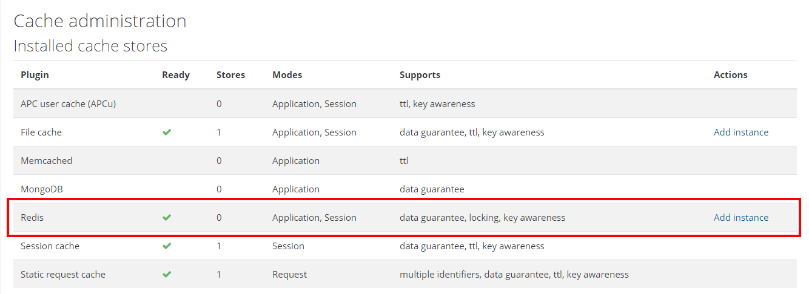
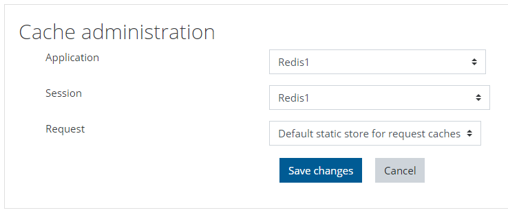

# Configuring Redis Cache with Moodle

**TLDR**: When deploying the NGINX-based Moodle image, Redis session handling, application caching, and lock configuration are automatically configured during the first run via `setup_moodle.sh` using the environment variables defined in `moodle-configmap-nginx.yaml`.

This document serves as a reference for understanding or manually adjusting the Redis configuration in `config.php`, Moodle UI, or via the Moodle CLI.

> Manual adjustments should only be performed after Moodle's initial installation process finishes and the application is up and running.

## 1. Add or verify entries in Moodle's config.php file

Modern Moodle on Google Cloud stores both `moodle` and `moodledata` directories on the shared persistent volume, and Moodle's `config.php` file sits inside the `moodle` directory.

Once mounted or accessed via a running pod, inspect `/var/www/html/moodle/config.php` (or `<MOODLE_PATH>/config.php`):

```php
// Set local cache dir for pod's tmp folder
$CFG->localcachedir = '/var/local/cache';

// Redis session handler (requires redis server and redis extension):
$CFG->session_handler_class = '\core\session\redis';
$CFG->session_redis_host = '<IP-REDIS-SERVICE>';
$CFG->session_redis_port = 6379;                                      // Optional.
$CFG->session_redis_database = 0;                                     // Optional, default is db 0.
$CFG->session_redis_auth = '<AUTH-STRING-REDIS-SERVICE>';             // Optional, default is don't set one.
$CFG->session_redis_prefix = 'mdl_sessid_';                           // Optional, default is don't set one.
$CFG->session_redis_acquire_lock_timeout = 120;                       // Default is 2 minutes.
$CFG->session_redis_acquire_lock_warn = 0;                            // If set logs early warning if a lock has not been acquired.
$CFG->session_redis_lock_expire = 7200;                               // Optional, defaults to session timeout.
$CFG->session_redis_lock_retry = 100;                                 // Optional wait between lock attempts in ms, default is 100.
```

Save the file and restart the deployment pods if needed:

```bash
kubectl rollout restart deployment/moodle -n moodle
kubectl get pods -n moodle -w
```

## 2. Create a mapping for Redis from Moodle UI

1. Log in to Moodle's UI with administrative credentials.

2. Navigate to "Site administration" > "Plugins" > "Caching" > "Configuration".

3. Under "Installed cache stores", locate "Redis" and click "Add instance":

<p align="center">
    
</p>

4. Configure the store instance:
   1. Give your Redis instance a name (e.g., `moodle_redis_1`) and set the `IP:port` for the Memorystore for Redis server.
   2. The new instance will appear under "Configured store instances" with a "Ready" status.

5. Under "Stores used when no mapping is present", click "Edit mappings" and select your Redis instance for the "Application" and "Session" caches:

<p align="center">
    
</p>

## 3. CLI-based Redis Configuration Reference

The following commands are provided as a reference for configuring Redis sessions directly via the Moodle CLI:

```bash
# Redis session configuration via Moodle CLI
sudo -u www php -d max_input_vars=10000 $MOODLE_PATH/admin/cli/cfg.php --name="session_handler_class" --set='\core\session\redis'
sudo -u www php -d max_input_vars=10000 $MOODLE_PATH/admin/cli/cfg.php --name="session_redis_database" --set=0
sudo -u www php -d max_input_vars=10000 $MOODLE_PATH/admin/cli/cfg.php --name="session_redis_host" --set=$REDIS_SESSION_ID_HOST
sudo -u www php -d max_input_vars=10000 $MOODLE_PATH/admin/cli/cfg.php --name="session_redis_port" --set=$REDIS_SESSION_ID_PORT
sudo -u www php -d max_input_vars=10000 $MOODLE_PATH/admin/cli/cfg.php --name="session_redis_auth" --set=$REDIS_SESSION_ID_AUTH_STRING
sudo -u www php -d max_input_vars=10000 $MOODLE_PATH/admin/cli/cfg.php --name="session_redis_prefix" --set='mdl_sessid_'
sudo -u www php -d max_input_vars=10000 $MOODLE_PATH/admin/cli/cfg.php --name="session_redis_acquire_lock_timeout" --set=120
sudo -u www php -d max_input_vars=10000 $MOODLE_PATH/admin/cli/cfg.php --name="session_redis_acquire_lock_warn" --set=0
sudo -u www php -d max_input_vars=10000 $MOODLE_PATH/admin/cli/cfg.php --name="session_redis_lock_expire" --set=7200
sudo -u www php -d max_input_vars=10000 $MOODLE_PATH/admin/cli/cfg.php --name="session_redis_lock_retry" --set=100
sudo -u www php -d max_input_vars=10000 $MOODLE_PATH/admin/cli/cfg.php --name="session_redis_serializer_use_igbinary" --set=true
sudo -u www php -d max_input_vars=10000 $MOODLE_PATH/admin/cli/cfg.php --name="session_redis_compressor" --set='gzip'
```

## 4. Large-Scale Deployments: Memorystore for Redis Cluster (MRC)

For large-scale Moodle 5.2+ deployments (see [Issue #23](https://github.com/google/moodle-on-gcp/issues/23) and [MDL-59196](https://tracker.moodle.org/browse/MDL-59196)), you can provision **Google Cloud Memorystore for Redis Cluster** instead of a single standalone instance by setting `CREATE_REDIS=false` and `CREATE_REDIS_CLUSTER=true` in `0-infra/envs.sh`.

Because Moodle's native `\core\session\redis` and `cachestore_redis` classes activate `RedisCluster` mode when `$CFG->session_redis_host` (or the cache store server field) contains multiple comma-separated `host:port` entries, and Memorystore for Redis Cluster exposes a single Discovery Endpoint (`<DISCOVERY-IP>:6379`), repeat the discovery endpoint twice separated by a comma so `phpredis` initializes `RedisCluster`:

```php
$CFG->session_handler_class = '\core\session\redis';
$CFG->session_redis_host = '<DISCOVERY-ENDPOINT-IP>:6379,<DISCOVERY-ENDPOINT-IP>:6379';
```

