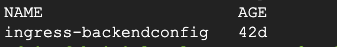

# Deploying Backend Configuration (`BackendConfig`)

> This document assumes that the working machine from where you are running commands has access to the Google Kubernetes Engine (GKE) control plane.

1. Connect to the GKE cluster via the command line and update local cluster credentials:

```bash
gcloud container clusters get-credentials <GKE-NAME> \
    --region <GKE-REGION> \
    --project <PROJECT-ID>
```

2. Create the backend configurations in GKE (both the primary Cloud CDN-enabled `ingress-backendconfig` and the dedicated long-timeout `ingress-backendconfig-uploads` for file uploads):

```bash
kubectl apply -f 6-backendconfig/ingress-backendconfig-nginx.yaml
kubectl apply -f 6-backendconfig/ingress-backendconfig-nginx-uploads.yaml
```

For full details on how Cloud CDN is configured with Moodle (`USE_ORIGIN_HEADERS`, `slasharguments`, `Set-Cookie` stripping on public versioned assets, and private cache bypass on `/pluginfile.php`), see [Configuring Cloud CDN and Dedicated Upload Pods](configuring-cloud-cdn.md).

3. Verify that the backend configurations were created:

```bash
kubectl get backendconfig -n moodle
```

<p align="left">
    
</p>
