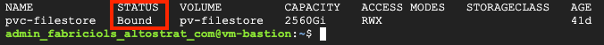

# Deploying Persistent Volume Claim (PVC)

> This document assumes that the working machine from where you are running commands has access to the Google Kubernetes Engine (GKE) control plane.

1. Connect to the GKE cluster via command line and update local cluster credentials:

```bash
gcloud container clusters get-credentials <GKE-NAME> \
    --region <GKE-REGION> \
    --project <PROJECT-ID>
```

2. Create the PVC matching your chosen `STORAGE_TYPE` (`filestore` or `regional-pd`). Storage sizes (`$PVC_STORAGE_SIZE`, `$PVC_LIMIT_STORAGE_SIZE`, `$PD_DISK_SIZE`) are configured in `0-infra/envs.sh` and rendered by `5a-deployment-no-helm/create-config-files.sh`:

### Option A: Cloud Filestore (`STORAGE_TYPE="filestore"`)

```bash
kubectl apply -f 3-pvc/pvc-filestore.yaml
```

### Option B: Regional Replicated Persistent Disk (`STORAGE_TYPE="regional-pd"`)

```bash
kubectl apply -f 3-pvc/pvc-regional-pd.yaml
```

3. Verify that the PVC was created and is properly bound:

```bash
kubectl get pvc -n moodle
```

<p align="left">
    
</p>
