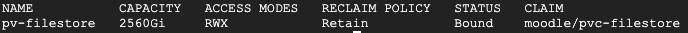

# Deploying Persistent Volume (PV)

> This document assumes that the working machine from where you are running commands has access to the Google Kubernetes Engine (GKE) control plane.

1. Connect to the GKE cluster via command line and update local cluster credentials:

```bash
gcloud container clusters get-credentials <GKE-NAME> \
    --region <GKE-REGION> \
    --project <PROJECT-ID>
```

2. Depending on your chosen `STORAGE_TYPE` in `0-infra/envs.sh` (see [Choosing and Configuring Storage](choosing-and-configuring-storage.md)), apply the corresponding Persistent Volume manifest:

### Option A: Cloud Filestore (`STORAGE_TYPE="filestore"`)

Update the `server` property under `nfs` in `1-pv/pv-filestore.yaml` (or set `FILESTORE_IP` in `0-infra/envs.sh` and run `5a-deployment-no-helm/create-config-files.sh` to populate both `server` and `capacity.storage` from `$PV_STORAGE_SIZE`):

```yaml
nfs:
  path: /moodleshare
  server: <YOUR-FILESTORE-INTERNAL-IP> # filestore's internal IP
```

Apply the Filestore PV:

```bash
kubectl apply -f 1-pv/pv-filestore.yaml
```

### Option B: Regional Replicated Persistent Disk (`STORAGE_TYPE="regional-pd"`)

Ensure `<YOUR-PROJECT-ID>`, `<YOUR-REGION>`, `<YOUR-ZONE>`, and `<YOUR-REPLICA-ZONE>` are populated in `1-pv/pv-regional-pd.yaml` (automatically rendered when you run `5a-deployment-no-helm/create-config-files.sh`), then apply:

```bash
kubectl apply -f 1-pv/pv-regional-pd.yaml
```

*(Alternatively, for dynamic Regional PD provisioning via GKE CSI driver, apply `kubectl apply -f 1-pv/storageclass-regional-pd.yaml`.)*

3. Verify that the Persistent Volume was created:

```bash
kubectl get pv
```

<p align="left">
    
</p>
