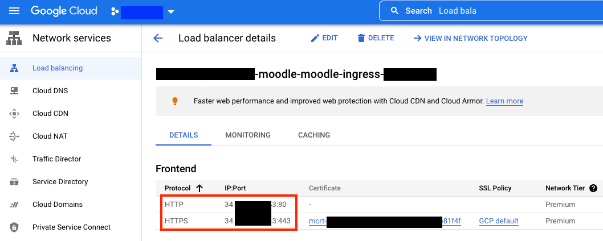
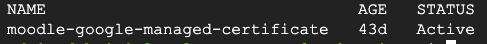

# Configuring SSL and forcing HTTPS redirect

> This document assumes that the working machine from where you pushing commands from has access to Google Kubernetes Engine (GKE) control plane.

This document highlights the steps needed to both create a new Google Cloud-managed certificate for Moodle's infrastructure and force HTTPS for every incoming request.

## Provisioning a new certificate managed by Google Cloud

The very first step is to replace values of a key variable in the `google-managed-ssl-certificate.yaml`, as follows.

1. Browse into directory `7-ssl-certificate-and-redirect`.

2. Replace the contents of the `google-managed-ssl-certificate.yaml` to either your given Load Balancer's IP Address to use .nip.io domain or your very own hostname.

If decided to go with nip.io domain, use the following command:

    Just replace the portion `<YOUR-LB-EXTERNAL-IP>` with the actual Load Balancer's public IP. That information can be gathered within the service blade in the Google Cloud console, as you can see below.

    <p align="center">
      
    </p>

    Or you can just combine the usage of `gcloud` and `sed` tools in a shell environment of your choice:

    ```
    MY_MOODLE_PUBLIC_IP_ADDRESS=$(gcloud compute addresses describe moodle-ingress-ip --global --format='get(address)')

    sed -i "s/<YOUR-LB-EXTERNAL-IP>/$MY_MOODLE_PUBLIC_IP_ADDRESS/g" 7-ssl-certificate-and-redirect/google-managed-ssl-certificate.yaml
    ```

If you have your own domain, use the following command:

    Just replace the portion `moodle.<YOUR-LB-EXTERNAL-IP>.nip.io` with the given hostname of your choice.

    Then create a DNS A record in your hostname's DNS pointing to the Google Cloud's Load Balancer's public IP address. That information can be gathered within the service blade in the Google Cloud console, as you can see below.

    <p align="center">
      
    </p>

    Or you can just combine the usage of `gcloud` and `sed` tools in a shell environment of your choice:

    ```
    MY_HOSTNAME="www.somesite.com"

    sed -i "s/moodle.<YOUR-LB-EXTERNAL-IP>.nip.io/$MY_HOSTNAME/g" 7-ssl-certificate-and-redirect/google-managed-ssl-certificate.yaml
    ```

3. From the command line, execute the following command line to apply the changes in the cluster.

```
kubectl apply -f google-managed-ssl-certificate.yaml
```

Verify the updates were properly applied by running the command below.

```
kubectl get managedcertificate -n moodle
```

> **Important Note ([Issue #33](https://github.com/google/moodle-on-gcp/issues/33)):** The `ManagedCertificate` resource will remain in the `Provisioning` state (`STATUS: Provisioning`) until you complete the next step ([Deploying Ingress](deploying-ingress.md)). Google Cloud Certificate Manager requires the External HTTP(S) Load Balancer (Ingress) to be actively routing traffic to healthy Moodle backend pods (returning HTTP 200) and the domain/`.nip.io` DNS record to resolve to the Load Balancer's public IP before it can complete domain validation and transition the certificate to `Active`.

<p align="left">
    
</p>

## Forcing HTTPS for incoming requests

To force HTTPS over HTTP just apply the configurations set up in the file `frontendconfig-redirect-http-to-https.yaml` to the ingress. To do that, run the command line below.

```
kubectl apply -f frontendconfig-redirect-http-to-https.yaml
```

Verify the configuration was properly applied to the ingress by running the following.

```
kubectl get frontendconfig -n moodle
```