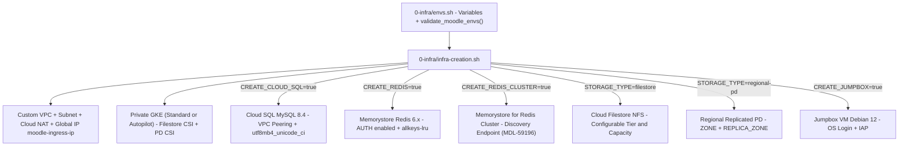

# GCP Infrastructure, Selective Adoption, and Cloud SQL MySQL 8.4

The `0-infra/` directory centralizes environment configuration (`0-infra/envs.sh`), automated provisioning (`0-infra/infra-creation.sh`), and lifecycle management (`0-infra/cleanup-moodle-install.sh`, `0-infra/infra-pause.sh`, `0-infra/infra-resume.sh`, and `0-infra/infra-destroy.sh`) for the Moodle topology on Google Cloud Platform (GCP).

## Centralized Configuration and Pre-Flight Validation (`0-infra/envs.sh`)

`0-infra/envs.sh` centralizes project, network, database, cache, and storage parameters:

- **Pre-Flight Validation (`validate_moodle_envs`)**: The `validate_moodle_envs()` function verifies that `PROJECT_NUMBER`, `PROJECT_ID`, and `REGION` are set and rejects empty values or unreplaced `<YOUR-...>` placeholders before invoking `gcloud`.
- **Fail-Fast Execution (`set -eo pipefail`) and `ENVS_FILE` Override**: All scripts in `0-infra/` run under `set -eo pipefail` (without global `-x` during sensitive operations) and load `source "${ENVS_FILE:-$SCRIPT_DIR/envs.sh}"`, allowing isolated environment profiles without modifying tracked templates.

## Selective Infrastructure Adoption

To allow organizations to reuse existing managed services (such as corporate Cloud SQL instances, Memorystore Redis, or pre-provisioned storage topologies), `0-infra/envs.sh` and `0-infra/infra-creation.sh` expose independent selective adoption toggles:

| Variable | Default Value | Behavior in `0-infra/infra-creation.sh` |
| :--- | :--- | :--- |
| `GKE_MODE` | `standard` | Selects between GKE `standard` (Dataplane V2 + explicit CSI drivers) and `autopilot` (`gcloud container clusters create-auto`, scaling compute cost to zero when pods are scaled down). |
| `STORAGE_TYPE` | `filestore` | Selects the storage modality (`filestore`, `regional-pd`, or `none`) and automatically adjusts defaults for `CREATE_FILESTORE` and `CREATE_REGIONAL_PD`. |
| `CREATE_CLOUD_SQL` | `true` | When `true`, interactively prompts for `MYSQL_ROOT_PASSWORD` (with double confirmation if unset), allocates the `moodle-managed-range-mysql` VPC Peering range, and provisions the Cloud SQL instance and `$MYSQL_DB` schema. |
| `CREATE_REDIS` | `true` | When `true`, provisions a Memorystore for Redis (`redis_6_x`) instance with authentication (`--enable-auth`) and `allkeys-lru` eviction policy. |
| `CREATE_REDIS_CLUSTER` | `false` | When `true`, provisions a Memorystore for Redis Cluster (`gcloud redis clusters create`) for large-scale deployments using `RedisCluster` in Moodle 5.2+ (`Issue #23` / `MDL-59196`). |
| `CREATE_FILESTORE` | `true` (if `filestore`) | When `true`, enables `file.googleapis.com`, allocates the `moodle-managed-range-filestore` peering range, and creates the Cloud Filestore instance with configurable tier (`FILESTORE_TIER`) and capacity (`FILESTORE_CAPACITY`). |
| `CREATE_REGIONAL_PD` | `true` (if `regional-pd`) | When `true`, creates a synchronously replicated regional persistent disk (`gcloud compute disks create --region="$REGION" --replica-zones=...`) across `$ZONE` and `$REPLICA_ZONE`. |
| `CREATE_JUMPBOX` | `true` | When `true`, creates the `vm-jumpbox-moodle` management VM (Debian 12 Bookworm, no external IP, `enable-oslogin=true`) for private GKE cluster administration via IAP. |

## VPC Network, Private GKE Cluster, and CSI Drivers

`0-infra/infra-creation.sh` builds a custom-mode VPC (`--mtu=1460`) with a primary subnet (`SUBNET_RANGE`, default `10.10.0.0/24`) and two GKE secondary ranges (`pod-range-gke-1` at `10.168.0.0/14` and `svc-range-gke-1` at `10.172.0.0/19`), along with Cloud Router and Cloud NAT for outbound internet access from private nodes.

The GKE cluster (`$GKE_NAME`) is provisioned with:
- **Standard Mode (`GKE_MODE=standard`)**: Dataplane V2 (`--enable-dataplane-v2`), private nodes (`--enable-private-nodes`), optional private endpoint, and `HttpLoadBalancing`, `HorizontalPodAutoscaling`, `GcpFilestoreCsiDriver`, and `GcePersistentDiskCsiDriver` addons.
- **Autopilot Mode (`GKE_MODE=autopilot`)**: Provisioned via `gcloud container clusters create-auto` with `--enable-private-nodes` and dedicated secondary ranges, where CSI drivers and elastic node scaling are managed natively by GKE Autopilot.

## Cloud SQL MySQL 8.4 for Moodle 5.0+

Starting with Moodle 5.0 (including Moodle 5.1, 5.2.4, and 5.3), Moodle's environment check requires at least **MySQL 8.4** (`MYSQL_8_4`).

- `0-infra/envs.sh` sets `MYSQL_DATABASE_VERSION="${MYSQL_DATABASE_VERSION:-MYSQL_8_4}"` (which can be overridden to `MYSQL_8_0` if deploying Moodle 4.x).
- `0-infra/infra-creation.sh` provisions the Cloud SQL instance with `--database-version="${MYSQL_DATABASE_VERSION:-MYSQL_8_4}"`, `--storage-type=SSD`, `--storage-auto-increase`, `--enable-bin-log`, and creates the `$MYSQL_DB` database with `utf8mb4` charset and `utf8mb4_unicode_ci` collation.
- If `MYSQL_ROOT_PASSWORD` is not exported in the environment and `CREATE_CLOUD_SQL=true`, `0-infra/infra-creation.sh` prompts silently (`read -rsp`) with confirmation validation and disables `set -x` (`{ set +x; } 2>/dev/null`) before instance creation to prevent credential leakage in logs.

## Infrastructure Cleanup and Lifecycle Scripts (`cleanup-moodle-install.sh`, `infra-destroy.sh`, `infra-pause.sh`, `infra-resume.sh`)

`0-infra/` includes full lifecycle and cost-control scripts:
- **`0-infra/cleanup-moodle-install.sh`**: Recreates the `$MYSQL_DB` schema in Cloud SQL (when `CREATE_CLOUD_SQL=true`) and resets the storage volumes (`filestore` or `regional-pd`) without destroying the base infrastructure.
- **`0-infra/infra-destroy.sh`**: Selective teardown counterpart to `0-infra/infra-creation.sh`. Deletes only the Moodle resources (`$GKE_NAME`, `$FILESTORE_NAME`, `$PD_DISK_NAME`, `$REDIS_NAME` / `$REDIS_CLUSTER_NAME`, `$MYSQL_INSTANCE_NAME`, and `$ARTIFACT_REGISTRY_NAME`), preserving shared VPCs and subnets unless `--destroy-network` is explicitly passed.
- **`0-infra/infra-pause.sh` and `0-infra/infra-resume.sh`**: Hibernate the environment without data loss by scaling GKE Deployments to `0` replicas (eliminating GKE Autopilot compute charges), stopping the Cloud SQL instance (`--activation-policy=NEVER`), and optionally deleting/recreating the Memorystore Redis instance (`--delete-redis` / `--recreate-redis`), automatically patching the new `REDIS_HOST` IP in Kubernetes `ConfigMaps` upon resume.
