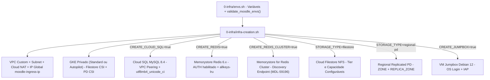

# Infraestrutura GCP, Adoção Seletiva e Cloud SQL MySQL 8.4

O diretório `0-infra/` concentra toda a parametrização (`0-infra/envs.sh`), o provisionamento automatizado (`0-infra/infra-creation.sh`) e os scripts de ciclo de vida (`0-infra/cleanup-moodle-install.sh`, `0-infra/infra-pause.sh`, `0-infra/infra-resume.sh` e `0-infra/infra-destroy.sh`) da topologia do Moodle no Google Cloud Platform (GCP).

## Parametrização Central e Validação Pre-Flight (`0-infra/envs.sh`)

O arquivo `0-infra/envs.sh` centraliza os parâmetros de projeto, rede, banco de dados, cache e armazenamento:

- **Validação Pre-Flight (`validate_moodle_envs`)**: A função `validate_moodle_envs()` verifica se `PROJECT_NUMBER`, `PROJECT_ID` e `REGION` foram preenchidos e rejeita valores vazios ou que ainda contenham placeholders no formato `<YOUR-...>`, interrompendo a execução antes de disparar chamadas `gcloud` inválidas.
- **Execução Segura (`set -eo pipefail`) e Sobrescrita de `ENVS_FILE`**: Todos os scripts em `0-infra/` utilizam `set -eo pipefail` (sem `-x` global durante operações sensíveis) e carregam `source "${ENVS_FILE:-$SCRIPT_DIR/envs.sh}"`, permitindo injetar perfis de ambiente isolados sem alterar o template rastreado pelo Git.

## Adoção Seletiva de Componentes de Infraestrutura

Para permitir que organizações reutilizem serviços gerenciados já existentes (como instâncias corporativas de Cloud SQL, Memorystore Redis ou topologias de storage pré-provisionadas), `0-infra/envs.sh` e `0-infra/infra-creation.sh` expõem flags independentes de adoção seletiva:

| Variável | Valor Padrão | Comportamento em `0-infra/infra-creation.sh` |
| :--- | :--- | :--- |
| `GKE_MODE` | `standard` | Seleciona entre GKE `standard` (Dataplane V2 + drivers CSI explícitos) e `autopilot` (`gcloud container clusters create-auto`, com escala a zero pods de custo computacional). |
| `STORAGE_TYPE` | `filestore` | Define a modalidade de armazenamento (`filestore`, `regional-pd` ou `none`) e ajusta automaticamente os padrões de `CREATE_FILESTORE` e `CREATE_REGIONAL_PD`. |
| `CREATE_CLOUD_SQL` | `true` | Quando `true`, solicita interativamente `MYSQL_ROOT_PASSWORD` (com confirmação dupla se não definida), cria o range de VPC Peering `moodle-managed-range-mysql` e provisiona a instância Cloud SQL e o schema `$MYSQL_DB`. |
| `CREATE_REDIS` | `true` | Quando `true`, provisiona uma instância Memorystore for Redis (`redis_6_x`) com autenticação (`--enable-auth`) e política `allkeys-lru`. |
| `CREATE_REDIS_CLUSTER` | `false` | Quando `true`, provisiona um cluster Memorystore for Redis Cluster (`gcloud redis clusters create`) para implantações de larga escala com `RedisCluster` no Moodle 5.2+ (`Issue #23` / `MDL-59196`). |
| `CREATE_FILESTORE` | `true` (se `filestore`) | Quando `true`, habilita `file.googleapis.com`, aloca o peering `moodle-managed-range-filestore` e cria a instância Cloud Filestore com tier (`FILESTORE_TIER`) e capacidade (`FILESTORE_CAPACITY`) customizáveis. |
| `CREATE_REGIONAL_PD` | `true` (se `regional-pd`) | Quando `true`, cria um disco persistente regionalmente replicado (`gcloud compute disks create --region="$REGION" --replica-zones=...`) entre `$ZONE` e `$REPLICA_ZONE`. |
| `CREATE_JUMPBOX` | `true` | Quando `true`, cria a VM de suporte `vm-jumpbox-moodle` (Debian 12 Bookworm, sem IP externo, com `enable-oslogin=true`) para administração privada do cluster GKE. |

## Rede VPC, Cluster GKE Privado e Drivers CSI

O script `0-infra/infra-creation.sh` constrói uma VPC em modo customizado (`--mtu=1460`) com sub-rede primária (`SUBNET_RANGE`, padrão `10.10.0.0/24`) e dois ranges secundários dedicados ao GKE (`pod-range-gke-1` em `10.168.0.0/14` e `svc-range-gke-1` em `10.172.0.0/19`), além de Cloud Router e Cloud NAT para saída à internet dos nós privados.

O cluster GKE (`$GKE_NAME`) é provisionado com:
- **Modo Standard (`GKE_MODE=standard`)**: Dataplane V2 (`--enable-dataplane-v2`), nós privados (`--enable-private-nodes`), endpoint privado opcional e addons `HttpLoadBalancing`, `HorizontalPodAutoscaling`, `GcpFilestoreCsiDriver` e `GcePersistentDiskCsiDriver`.
- **Modo Autopilot (`GKE_MODE=autopilot`)**: Provisionado via `gcloud container clusters create-auto` com `--enable-private-nodes` e ranges secundários dedicados, onde os drivers CSI e o escalonamento elástico de nós são gerenciados nativamente pelo GKE Autopilot.

## Cloud SQL MySQL 8.4 para Moodle 5.0+

A partir do Moodle 5.0 (incluindo Moodle 5.1, 5.2.4 e 5.3), o verificador de ambiente do Moodle exige no mínimo **MySQL 8.4** (`MYSQL_8_4`).

- `0-infra/envs.sh` define `MYSQL_DATABASE_VERSION="${MYSQL_DATABASE_VERSION:-MYSQL_8_4}"` (permitindo sobrescrever para `MYSQL_8_0` caso o usuário deseje implantar Moodle 4.x).
- `0-infra/infra-creation.sh` provisiona a instância Cloud SQL com `--database-version="${MYSQL_DATABASE_VERSION:-MYSQL_8_4}"`, `--storage-type=SSD`, `--storage-auto-increase`, `--enable-bin-log` e cria o banco `$MYSQL_DB` com charset `utf8mb4` e collation `utf8mb4_unicode_ci`.
- Caso `MYSQL_ROOT_PASSWORD` não esteja exportada no ambiente e `CREATE_CLOUD_SQL=true`, `0-infra/infra-creation.sh` solicita a senha em modo silencioso (`read -rsp`) com validação de confirmação e desabilita `set -x` (`{ set +x; } 2>/dev/null`) antes da criação da instância para evitar vazamento de credenciais em logs.

## Limpeza e Ciclo de Vida de Infraestrutura (`cleanup-moodle-install.sh`, `infra-destroy.sh`, `infra-pause.sh`, `infra-resume.sh`)

O diretório `0-infra/` inclui scripts completos para gerenciamento de ciclo de vida e controle de custos:
- **`0-infra/cleanup-moodle-install.sh`**: Recria o banco `$MYSQL_DB` no Cloud SQL (quando `CREATE_CLOUD_SQL=true`) e limpa/recria os volumes de armazenamento (`filestore` ou `regional-pd`) sem destruir a infraestrutura base.
- **`0-infra/infra-destroy.sh`**: Contrapartida direta de desprovisionamento seletivo para `0-infra/infra-creation.sh`. Remove apenas os recursos do Moodle (`$GKE_NAME`, `$FILESTORE_NAME`, `$PD_DISK_NAME`, `$REDIS_NAME` / `$REDIS_CLUSTER_NAME`, `$MYSQL_INSTANCE_NAME` e `$ARTIFACT_REGISTRY_NAME`), preservando VPCs e sub-redes compartilhadas a menos que `--destroy-network` seja informado explicitamente.
- **`0-infra/infra-pause.sh` e `0-infra/infra-resume.sh`**: Permitem hibernar o ambiente sem perda de dados escalando os Deployments do GKE para `0` réplicas (zerando a cobrança de computação no GKE Autopilot), desligando a instância Cloud SQL (`--activation-policy=NEVER`) e opcionalmente removendo/recriando a instância Memorystore Redis (`--delete-redis` / `--recreate-redis`), atualizando automaticamente o `REDIS_HOST` nos `ConfigMaps` do Kubernetes ao recriar o Redis.
