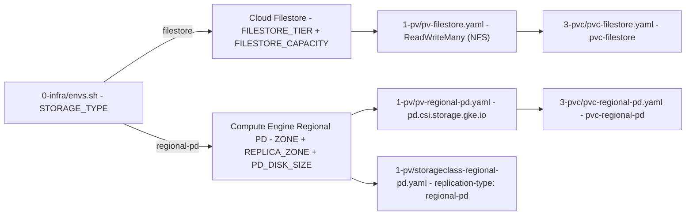

# Storage Modalities: Filestore vs. Regional Replicated Persistent Disk

Moodle stores its data directory (`$CFG->dataroot`) and, in this repository's standard shared-storage topology, the shared application tree (`/$MOODLE_ROOT_PATH_NO_SLASH/moodle`) and runtime configuration directories (`/etc/nginx`, `/etc/php83`, `/etc/nginx-uploads`, `/etc/php83-uploads`) on a persistent volume mounted by GKE pods.

Via the `STORAGE_TYPE` variable in `0-infra/envs.sh`, the repository supports three storage adoption modes:

1. **`STORAGE_TYPE="filestore"` (Default)**: Managed Cloud Filestore over NFS (`ReadWriteMany`).
2. **`STORAGE_TYPE="regional-pd"`**: Compute Engine Regional Replicated Persistent Disk synchronously replicated across two zones (`$ZONE` and `$REPLICA_ZONE`) via the `pd.csi.storage.gke.io` CSI driver.
3. **`STORAGE_TYPE="none"`**: Skips storage provisioning in `0-infra/infra-creation.sh` to allow integrating pre-existing external volumes or sidecar replication layers.

## Comparison: Cloud Filestore vs. Regional Replicated PD

| Feature | Cloud Filestore (`STORAGE_TYPE="filestore"`) | Regional Replicated Persistent Disk (`STORAGE_TYPE="regional-pd"`) |
| :--- | :--- | :--- |
| **Protocol / Driver** | NFSv3 (`nfs` in `PersistentVolume`) | Block storage via CSI (`pd.csi.storage.gke.io`, `fsType: ext4`) |
| **Access Mode (`accessModes`)** | `ReadWriteMany` (`RWX`) concurrently across multiple GKE nodes | `ReadWriteOnce` (`RWO`, pods co-located on the same node with automatic cross-zone failover) or `ReadOnlyMany` (`ROX`) |
| **Replication / High Availability** | Zonal (`BASIC_HDD`, `BASIC_SSD`, `ZONAL`) or Regional (`REGIONAL`, `ENTERPRISE`) | Native synchronous block replication across two zones (`$ZONE` and `$REPLICA_ZONE`) |
| **Minimum Capacity** | `1TB` (`BASIC_HDD`, `ZONAL`, `REGIONAL`) or `2.5TB` (`BASIC_SSD`) | Starting from `10Gi`–`200Gi` (`PD_DISK_SIZE="200Gi"` by default) |
| **Entry Cost** | Higher due to the 1 TiB / 2.5 TiB minimum capacity | Significantly lower for small/medium production or HA staging environments |

## Configurable Sizes and Capacities (`0-infra/envs.sh` and `create-config-files.sh`)

All storage capacity and tier variables are defined in `0-infra/envs.sh` and propagated automatically into the Kubernetes manifests by `5a-deployment-no-helm/create-config-files.sh`:

- **Cloud Filestore**:
  - `FILESTORE_TIER`: `BASIC_SSD` (default), `BASIC_HDD`, `ZONAL`, `REGIONAL`, or `ENTERPRISE`. In `0-infra/infra-creation.sh`, `REGIONAL` and `ENTERPRISE` tiers use `--location="$REGION"`, whereas zonal tiers use `--zone="$ZONE"`.
  - `FILESTORE_CAPACITY`: Capacity of the Filestore instance (default `2.5TB`).
  - `FILESTORE_SHARE_NAME`: Name of the NFS share (default `moodleshare`).
- **Regional Replicated Persistent Disk (`regional-pd`)**:
  - `REPLICA_ZONE`: Secondary zone in the same region (`$REGION-b`) for synchronous replication alongside the primary zone `$ZONE` (`$REGION-a`).
  - `PD_DISK_NAME`: Name of the regional disk in Compute Engine.
  - `PD_DISK_TYPE`: `pd-balanced` (default), `pd-ssd`, `pd-standard`, or `hyperdisk-balanced-high-availability`.
  - `PD_DISK_SIZE`: Size of the regional disk and corresponding PV/PVC (default `200Gi`).
  - `PD_ACCESS_MODE`: Volume access mode (default `ReadWriteOnce`).
- **PV and PVC Sizes (`PV_STORAGE_SIZE`, `PVC_STORAGE_SIZE`, `PVC_LIMIT_STORAGE_SIZE`)**:
  - For `STORAGE_TYPE="filestore"`, defaults are `PV_STORAGE_SIZE="2.5Ti"`, `PVC_STORAGE_SIZE="300Gi"`, `PVC_LIMIT_STORAGE_SIZE="500Gi"`, and `PVC_CLAIM_NAME="pvc-filestore"`.
  - For `STORAGE_TYPE="regional-pd"`, defaults automatically adjust to `200Gi` and `PVC_CLAIM_NAME="pvc-regional-pd"`.

## Static vs. Dynamic Provisioning for Regional Replicated PD

The repository supports both static and dynamic provisioning of regional replicated disks on GKE:

1. **Static Provisioning (`1-pv/pv-regional-pd.yaml` + `3-pvc/pvc-regional-pd.yaml`)**:
   - `0-infra/infra-creation.sh` creates the regional disk with `--region="$REGION"` and `--replica-zones="projects/$PROJECT_ID/zones/$ZONE,projects/$PROJECT_ID/zones/$REPLICA_ZONE"`.
   - `1-pv/pv-regional-pd.yaml` references `volumeHandle: projects/$PROJECT_ID/regions/$REGION/disks/$PD_DISK_NAME` via `driver: pd.csi.storage.gke.io` and constrains scheduling to nodes in those two zones via `nodeAffinity` (`topology.gke.io/zone in [$ZONE, $REPLICA_ZONE]`).
2. **Dynamic Provisioning (`1-pv/storageclass-regional-pd.yaml`)**:
   - Defines a `StorageClass` (`moodle-regional-pd`) with `provisioner: pd.csi.storage.gke.io`, `replication-type: regional-pd`, `type: $PD_DISK_TYPE`, `zones: $ZONE, $REPLICA_ZONE`, `allowVolumeExpansion: true`, and `volumeBindingMode: WaitForFirstConsumer`.
