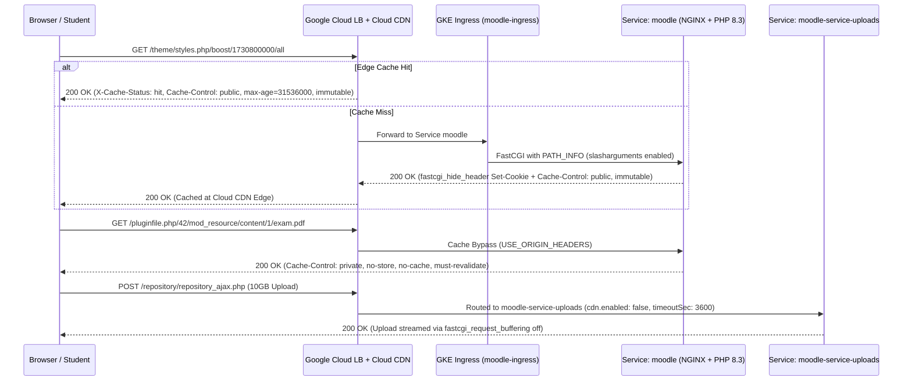

# Cloud CDN for Moodle, NGINX/PHP-FPM Tuning, and Ingress Routing

For Google Cloud CDN to accelerate Moodle 5.2+ static assets without breaking authenticated user sessions, causing `404 Not Found` on internal `X-Accel-Redirect` handoffs, or exposing private course files, configuration is coordinated across three layers: `4-moodle-image-builder/config.php.template`, `4-moodle-image-builder/base/etc/nginx/nginx.conf-template`, and `6-backendconfig/ingress-backendconfig-nginx.yaml`.

## 1. Enabling `slasharguments`, `PATH_INFO`, and `X-Accel-Redirect` (`^~`) in Moodle and NGINX

Moodle serves stylesheets, JavaScript/AMD bundles, YUI combos, web fonts, and theme images through versioned PHP entrypoints (`/theme/styles.php`, `/theme/image.php`, `/theme/font.php`, `/theme/javascript.php`, `/theme/yui_combo.php`, `/lib/javascript.php`, `/lib/requirejs.php`).

1. In `4-moodle-image-builder/config.php.template`, `$CFG->slasharguments = true;` instructs Moodle to generate path-based URLs containing the embedded theme/JS revision timestamp (e.g., `/theme/styles.php/boost/1730800000/all`).
2. In `4-moodle-image-builder/base/etc/nginx/nginx.conf-template`, all FastCGI blocks execute `fastcgi_split_path_info ^(.+\.php)(/.+)$;` and pass `fastcgi_param PATH_INFO $fastcgi_path_info;` and `fastcgi_param SCRIPT_FILENAME $document_root$fastcgi_script_name;`, which is required on Alpine NGINX for Moodle `slasharguments` and SCORM packages.
3. **Protecting `X-Accel-Redirect` with `location ^~`**: When `$CFG->xsendfile = "X-Accel-Redirect"` is active in `config.php.template`, PHP-FPM writes compiled fonts, icons, and JS bundles into `/tmp/moodle/localcache/` and returns `X-Accel-Redirect: /localcachedir/...`. In NGINX, the internal blocks use the `^~` prefix modifier (`location ^~ /localcachedir/` and `location ^~ /dataroot/`) to prevent the static file extension regex (`location ~* \.(jpg|...|woff2|...)$`) from hijacking internal redirects and returning `404 Not Found`.

## 2. NGINX Cache Control Rules and Streaming Uploads

Google Cloud CDN **refuses to cache HTTP responses carrying a `Set-Cookie` header**. Furthermore, using `CACHE_ALL_STATIC` indiscriminately on Cloud CDN would risk caching private course files served through `/pluginfile.php/.../document.pdf` (whose URL ends in `.pdf`).

Therefore, `4-moodle-image-builder/base/etc/nginx/nginx.conf-template` splits Moodle PHP endpoints into three distinct locations:

1. **Public Revisioned Moodle Asset Loaders (`/theme/(styles|image|font|javascript|yui_combo)\.php` and `/lib/(javascript|requirejs)\.php`)**:
   - Strips `Set-Cookie`, `Pragma`, and `Cache-Control` emitted by PHP-FPM (`fastcgi_hide_header Set-Cookie; fastcgi_hide_header Pragma; fastcgi_hide_header Cache-Control;`).
   - Adds `add_header Cache-Control "public, max-age=31536000, immutable";`, allowing Cloud CDN to cache revisioned assets at the edge for up to 1 year (automatically invalidated whenever Moodle increments `themerev` or `jsrev`).
2. **Authenticated File, Upload, and Login Endpoints (`/pluginfile.php`, `/draftfile.php`, `/tokenpluginfile.php`, `/webservice/pluginfile.php`, `/webservice/upload.php`, `/repository/`, `/login/`)**:
   - Enforces `add_header Cache-Control "private, no-store, no-cache, must-revalidate" always;`, guaranteeing that private course files, user drafts, and authentication responses are never cached by Cloud CDN.
   - Enables `fastcgi_request_buffering off;` so 10 GB+ multipart uploads stream directly to PHP-FPM without writing a duplicate temporary copy into `/tmp/nginx/client_temp`.
3. **Direct Static Files (`*.jpg`, `*.png`, `*.css`, `*.js`, `*.svg`, `*.woff2`, etc.)**:
   - Sets `expires 30d; add_header Cache-Control "public, max-age=2592000";`.

## 3. `BackendConfig` Configuration (`USE_ORIGIN_HEADERS` vs. `uploads`)

- **`6-backendconfig/ingress-backendconfig-nginx.yaml` (`ingress-backendconfig`)**:
  - Enables Cloud CDN (`cdn.enabled: true`) with `cacheMode: USE_ORIGIN_HEADERS`, `negativeCaching: false`, `serveWhileStale: 86400`, and `cachePolicy` with `includeHost: true`, `includeProtocol: true`, and `includeQueryString: true` (essential to distinguish CSS and JS requests on `/theme/yui_combo.php?...`).
  - Injects diagnostic response headers `X-Cache-Status: {cdn_cache_status}` and `X-Cache-Pop: {cdn_cache_id}` via `customResponseHeaders`.
- **`6-backendconfig/ingress-backendconfig-nginx-uploads.yaml` (`ingress-backendconfig-uploads`)**:
  - Disables Cloud CDN (`cdn.enabled: false`) and increases `timeoutSec: 3600` and `drainingTimeoutSec: 60` to support long-running file uploads without hitting 30s/300s Load Balancer timeouts.

## 4. NGINX & PHP-FPM 8.3 Tuning and Ingress Routing

- **NGINX (`4-moodle-image-builder/base/etc/nginx/nginx.conf-template`)**:
  - `worker_processes auto;`, `server_tokens off;`, `keepalive_timeout 65;`, `fastcgi_buffers 16 16k;`, `fastcgi_buffer_size 32k;`, `client_max_body_size 50M;` (overridden to `10G` on upload pods), blocks `.bak` files, and restricts `/fpm-status` and `/fpm-ping` to `127.0.0.1`.
- **PHP-FPM 8.3 (`4-moodle-image-builder/base/etc/php83/php-fpm.d/moodle.conf` and `php.ini-template`)**:
  - `listen.backlog = 128`, `pm = ondemand`, `pm.max_children = 8` (overridden to `1` on upload pods via `PHP_FPM_MAX_CHILDREN`), `pm.process_idle_timeout = 10s`, `pm.max_requests = 500`, `request_terminate_timeout = 3600`, `memory_limit = 256M` (overridden to `1024M` on upload pods), and `expose_php = Off`.
- **Ingress Routing (`8-ingress/gce-ingress-external.yaml` and `8-ingress/nginx-ingress-external-this-is-optional.yaml`)**:
  - Routes `/repository/repository_ajax.php`, `/repository/draftfiles_ajax.php`, and `/webservice/upload.php` (`pathType: Exact`) to `moodle-service-uploads`, while `/*` (or `/`) is served by the primary `moodle` service.
