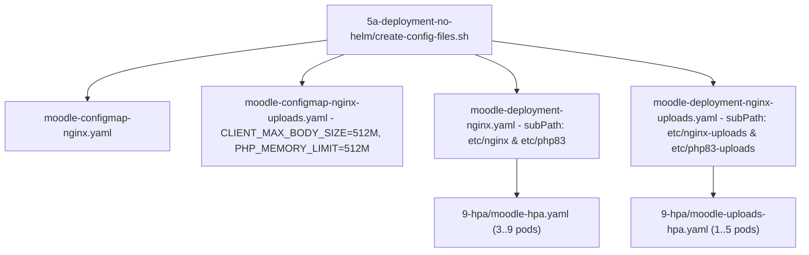

# GKE Deployments, Upload Pod Isolation, and Horizontal Pod Autoscaling

The `5a-deployment-no-helm/` directory implements a **two-tier application architecture on GKE**:
1. **Primary Web Tier (`moodle-deployment` + `moodle-configmap` + `moodle`)**: Sized for low-latency interactive navigation, multi-zone topology spread across 3 zones, Cloud CDN edge caching, and horizontal autoscaling between 3 and 9 replicas (`9-hpa/moodle-hpa.yaml`).
2. **Dedicated Uploads Tier (`moodle-deployment-uploads` + `moodle-configmap-uploads` + `moodle-service-uploads`)**: Sized for heavy file uploads (up to `512M` per request by default, `3600s` timeout, and `2Gi` RAM limit per pod), scaling independently between 1 and 5 replicas (`9-hpa/moodle-uploads-hpa.yaml`).

## 1. Automated Manifest Rendering (`create-config-files.sh`)

`5a-deployment-no-helm/create-config-files.sh` loads `0-infra/envs.sh` and runs `envsubst` across the templates in `5a-deployment-no-helm/deployment-templates/`:

- Automatically determines `PVC_CLAIM_NAME` (`pvc-regional-pd` when `STORAGE_TYPE="regional-pd"`, or `pvc-filestore` otherwise).
- Renders `moodle-configmap-nginx.yaml`, `moodle-configmap-nginx-uploads.yaml`, `moodle-deployment-nginx.yaml`, and `moodle-deployment-nginx-uploads.yaml` by substituting `$MOODLE_ROOT_PATH_NO_SLASH` and `$PVC_CLAIM_NAME`.
- Renders the storage manifests (`1-pv/pv-filestore.yaml`, `3-pvc/pvc-filestore.yaml`, `1-pv/storageclass-regional-pd.yaml`, `1-pv/pv-regional-pd.yaml`, `3-pvc/pvc-regional-pd.yaml`) using the capacities configured in `0-infra/envs.sh`.
- When run interactively (or when `ENABLE_SMTP="true"`), optionally prompts for `SMTP_PASSWORD` with double confirmation and injects the escaped value into `moodle-configmap-nginx.yaml` and `moodle-configmap-nginx-uploads.yaml`.

## 2. Configuration and Resource Isolation on Upload Pods

In the primary deployment (`moodle-deployment`), `/etc/nginx` and `/etc/php83` are mounted on the shared volume using `subPath: $MOODLE_ROOT_PATH_NO_SLASH/etc/nginx` and `subPath: $MOODLE_ROOT_PATH_NO_SLASH/etc/php83`.

If the dedicated upload pods mounted the same configuration `subPath`, the `sed -i` overrides executed by `setup_moodle.sh` on the upload pods would overwrite `php.ini` and `nginx.conf` for the primary web pods on shared storage. To prevent this collision:

- `5a-deployment-no-helm/moodle-deployment-nginx-uploads.yaml` mounts `/etc/nginx` at `subPath: $MOODLE_ROOT_PATH_NO_SLASH/etc/nginx-uploads` and `/etc/php83` at `subPath: $MOODLE_ROOT_PATH_NO_SLASH/etc/php83-uploads`, while sharing the same application code (`subPath: $MOODLE_ROOT_PATH_NO_SLASH/moodle`) and data directory (`subPath: $MOODLE_ROOT_PATH_NO_SLASH/moodledata`).
- `5a-deployment-no-helm/moodle-configmap-nginx-uploads.yaml` defines dedicated limits for large uploads:
  - `CLIENT_MAX_BODY_SIZE: "512M"`
  - `UPLOAD_MAX_FILESIZE: "512M"`
  - `POST_MAX_SIZE: "512M"`
  - `PHP_MAX_EXECUTION_TIME: "3600"`
  - `PHP_MAX_INPUT_TIME: "3600"`
  - `PHP_MEMORY_LIMIT: "512M"`
- Pods in `moodle-deployment-uploads` are configured with `limits.cpu: 500m` and `limits.memory: 2Gi` (`requests: 250m / 1Gi`), preventing concurrent file uploads from exhausting PHP-FPM workers or memory on the general student web tier.

## 3. Independent Horizontal Pod Autoscaling (`9-hpa/`)

- **`9-hpa/moodle-hpa.yaml`**: Scales `moodle-deployment` between `minReplicas: 3` and `maxReplicas: 9` based on `75%` average CPU utilization and `80%` memory utilization.
- **`9-hpa/moodle-uploads-hpa.yaml`**: Independently scales `moodle-deployment-uploads` between `minReplicas: 1` and `maxReplicas: 5` based on `75%` CPU and `80%` memory utilization.
