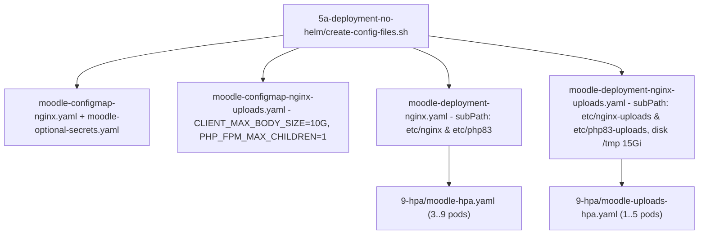

# GKE Deployments, 10GB Upload Pod Isolation, ProxySQL, and Horizontal Pod Autoscaling

The `5a-deployment-no-helm/` directory implements a **two-tier application architecture on GKE** (plus an optional **ProxySQL** connection-multiplexing tier for extreme concurrency):
1. **Primary Web Tier (`moodle-deployment` + `moodle-configmap` + `moodle`)**: Right-sized with `Guaranteed` QoS (`requests == limits`: `cpu: 1000m`, `memory: 2Gi`) for low-latency interactive navigation, multi-zone topology spread across 3 zones, Cloud CDN edge caching, and horizontal autoscaling between 3 and 9 replicas (`9-hpa/moodle-hpa.yaml`).
2. **Dedicated 10GB+ Uploads Tier (`moodle-deployment-uploads` + `moodle-configmap-uploads` + `moodle-service-uploads`)**: Sized for streaming file uploads up to `10G` per request without consuming container RAM (`emptyDir: { sizeLimit: 15Gi }` on disk rather than `medium: Memory` `tmpfs`), processing 1 heavy upload at a time (`PHP_FPM_MAX_CHILDREN: "1"`) with socket backlog queueing (`listen.backlog = 128`), and scaling between 1 and 5 replicas (`9-hpa/moodle-uploads-hpa.yaml`).
3. **Optional ProxySQL Connection Multiplexer (`moodle-proxysql`)**: Multiplexes thousands of concurrent PHP-FPM connections over a bounded pool of `200` backend Cloud SQL connections (`multiplexing=true`) during 100k–300k+ student load tests.

## 1. Automated Manifest Rendering and Secret Isolation (`create-config-files.sh`)

`5a-deployment-no-helm/create-config-files.sh` loads `0-infra/envs.sh` and runs `envsubst` across the templates in `5a-deployment-no-helm/deployment-templates/`:

- Automatically determines `PVC_CLAIM_NAME` (`pvc-regional-pd` when `STORAGE_TYPE="regional-pd"`, or `pvc-filestore` otherwise).
- Renders `moodle-configmap-nginx.yaml`, `moodle-configmap-nginx-uploads.yaml`, `moodle-optional-secrets.yaml` (`chmod 0600`), `moodle-deployment-nginx.yaml`, and `moodle-deployment-nginx-uploads.yaml`.
- Sources `DB_READ_REPLICA_PASSWORD`, `REDIS_SESSION_ID_AUTH_STRING`, `REDIS_APP_AUTH_STRING`, `REDIS_SESSION_AUTH_STRING`, `REDIS_LOCK_AUTH_STRING`, and `SMTP_PASSWORD` from the `moodle-optional-secrets` Kubernetes `Secret` (`optional: true`) rather than plaintext `ConfigMap` keys.

## 2. 10GB+ Streaming Uploads and SubPath Isolation (`moodle-deployment-uploads`)

To prevent `setup_moodle.sh`'s dynamic `sed -i` overrides on upload pods from overwriting `php.ini` and `nginx.conf` for the primary web pods on shared storage:

- `5a-deployment-no-helm/moodle-deployment-nginx-uploads.yaml` mounts `/etc/nginx` at `subPath: $MOODLE_ROOT_PATH_NO_SLASH/etc/nginx-uploads` and `/etc/php83` at `subPath: $MOODLE_ROOT_PATH_NO_SLASH/etc/php83-uploads`.
- **Disk-Backed `/tmp` (`emptyDir: { sizeLimit: 15Gi }`)**: While primary web pods mount `/tmp` with `medium: Memory` (`tmpfs`) to accelerate `X-Accel-Redirect` static assets, upload pods mount `/tmp` on node SSD ephemeral storage so 10 GB temporary upload files (`/tmp/phpXXXXXX`) consume zero container RAM.
- `5a-deployment-no-helm/moodle-configmap-nginx-uploads.yaml` sets:
  - `CLIENT_MAX_BODY_SIZE: "10G"`, `UPLOAD_MAX_FILESIZE: "10G"`, `POST_MAX_SIZE: "10G"`
  - `PHP_MAX_EXECUTION_TIME: "3600"`, `PHP_MAX_INPUT_TIME: "3600"`
  - `PHP_MEMORY_LIMIT: "1024M"`, `PHP_FPM_MAX_CHILDREN: "1"`

## 3. Pod Rightsizing (`Guaranteed` QoS), ProxySQL, and HPA (`9-hpa/`)

- **Guaranteed QoS Rightsizing (`requests == limits`)**: Both `moodle-deployment` and `moodle-deployment-uploads` set `requests` equal to `limits` (`cpu: 1000m`, `memory: 2Gi`), preventing CFS CPU throttling across PHP-FPM workers and ensuring accurate HPA scaling on GKE Autopilot.
- **Optional ProxySQL Tier (`5a-deployment-no-helm/moodle-proxysql.yaml`)**: Deploys a 2-replica `proxysql/proxysql:2.7.1` service (`moodle-proxysql:6033`) with `multiplexing=true` and `max_connections=200` to prevent `Too many connections` errors on Cloud SQL during massive load tests.
- **Independent HPAs (`9-hpa/moodle-hpa.yaml` and `9-hpa/moodle-uploads-hpa.yaml`)**: Scale `moodle-deployment` (`3..9` pods) and `moodle-deployment-uploads` (`1..5` pods) at `75%` CPU and `80%` memory utilization.
