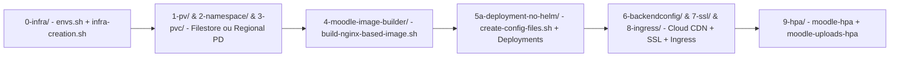

# Quickstart e Mapa Arquitetural do Moodle on GCP

Este repositório implementa uma arquitetura cloud-native completa para execução do **Moodle 5.2.4** (compatível também com Moodle 5.3 e 4.x) em **Google Kubernetes Engine (GKE)** com **Alpine 3.21 + NGINX + PHP 8.3**, **Cloud SQL para MySQL 8.4**, **Memorystore for Redis**, opções seletivas de armazenamento (**Cloud Filestore** ou **Regional Replicated Persistent Disk**), **pods dedicados de upload** e **Google Cloud CDN**.

## Fluxo Rápido de Implantação (Passo a Passo)

1. **Parametrizar o Ambiente (`0-infra/envs.sh`)**:
   - Preencha `PROJECT_NUMBER`, `PROJECT_ID`, `REGION`, `VPC_NAME`, `SUBNET_NAME` e escolha `STORAGE_TYPE` (`filestore`, `regional-pd` ou `none`), além dos tamanhos de armazenamento (`FILESTORE_TIER`, `FILESTORE_CAPACITY`, `PD_DISK_SIZE`, `PV_STORAGE_SIZE`, `PVC_STORAGE_SIZE`).
2. **Provisionar a Infraestrutura (`0-infra/infra-creation.sh`)**:
   - Execute `./0-infra/infra-creation.sh` para criar VPC, Cloud NAT, cluster GKE privado (com drivers CSI de Filestore e Persistent Disk), Cloud SQL (`MYSQL_8_4`), Memorystore Redis, Artifact Registry, armazenamento selecionado e VM Jumpbox.
3. **Renderizar os Manifestos Kubernetes (`5a-deployment-no-helm/create-config-files.sh`)**:
   - Execute `./5a-deployment-no-helm/create-config-files.sh` para gerar os manifestos de PV, PVC, StorageClass, ConfigMaps e Deployments (principal e uploads) parametrizados.
4. **Criar Namespace, PV e PVC (`1-pv/`, `2-namespace/`, `3-pvc/`)**:
   - Para Filestore: `kubectl apply -f 1-pv/pv-filestore.yaml -f 2-namespace/namespace-moodle.yaml -f 3-pvc/pvc-filestore.yaml`
   - Para Regional PD: `kubectl apply -f 1-pv/pv-regional-pd.yaml -f 2-namespace/namespace-moodle.yaml -f 3-pvc/pvc-regional-pd.yaml`
5. **Construir a Imagem Container (`4-moodle-image-builder/build-nginx-based-image.sh`)**:
   - Execute `./4-moodle-image-builder/build-nginx-based-image.sh` para compilar `preloadable_libiconv.so` e publicar a imagem NGINX + PHP 8.3 no Artifact Registry via Cloud Build.
6. **Implantar Secrets, ConfigMaps, Deployments e Services (`5a-deployment-no-helm/`)**:
   - Aplique `moodle-externaldb-secret.yaml`, `moodle-password-secret.yaml`, `moodle-configmap-nginx.yaml`, `moodle-configmap-nginx-uploads.yaml`, `moodle-deployment-nginx.yaml`, `moodle-deployment-nginx-uploads.yaml`, `moodle-service.yaml` e `moodle-service-uploads.yaml`.
7. **Configurar Cloud CDN, SSL, Ingress e HPA (`6-backendconfig/`, `7-ssl-certificate-and-redirect/`, `8-ingress/`, `9-hpa/`)**:
   - Aplique `6-backendconfig/ingress-backendconfig-nginx.yaml` e `6-backendconfig/ingress-backendconfig-nginx-uploads.yaml`, os manifestos de certificado/redirect em `7-ssl-certificate-and-redirect/`, o Ingress em `8-ingress/gce-ingress-external.yaml` e os HPAs em `9-hpa/`.

## Mapa de Roteamento de Tarefas da Documentação OpenWiki

| Objetivo ou Subsistema | Página OpenWiki de Referência | Principais Arquivos no Repositório |
| :--- | :--- | :--- |
| **Provisionamento GCP, Adoção Seletiva e Cloud SQL MySQL 8.4** | [Infraestrutura GCP, Adoção Seletiva e Cloud SQL MySQL 8.4](/openwiki/architecture/infrastructure-and-networking.md) | `0-infra/envs.sh`, `0-infra/infra-creation.sh`, `0-infra/cleanup-moodle-install.sh` |
| **Escolha entre Cloud Filestore e Regional Replicated PD (`regional-pd`)** | [Modalidades de Storage: Filestore vs. Regional Replicated Persistent Disk](/openwiki/architecture/storage-modalities.md) | `1-pv/pv-filestore.yaml`, `1-pv/pv-regional-pd.yaml`, `1-pv/storageclass-regional-pd.yaml`, `3-pvc/pvc-filestore.yaml`, `3-pvc/pvc-regional-pd.yaml` |
| **Imagem Container Alpine 3.21 + PHP 8.3, `preloadable_libiconv.so` e Moodle 5.2+ `/public`** | [Imagem Container NGINX + PHP 8.3, GNU libiconv e Bootstrap do Moodle 5.2+](/openwiki/runtime/container-image-moodle52-php83.md) | `4-moodle-image-builder/Dockerfile.nginx`, `4-moodle-image-builder/scripts/build-gnu-libiconv.sh`, `4-moodle-image-builder/base/opt/setup_moodle.sh` |
| **Deployments GKE, Isolamento de Pods de Upload e HPA** | [Deployments GKE, Isolamento de Pods de Upload e HPA](/openwiki/operations/gke-deployments-and-uploads-isolation.md) | `5a-deployment-no-helm/create-config-files.sh`, `5a-deployment-no-helm/moodle-deployment-nginx.yaml`, `5a-deployment-no-helm/moodle-deployment-nginx-uploads.yaml`, `9-hpa/` |
| **Cloud CDN com Moodle Funcional, Tuning NGINX/PHP-FPM e Ingress** | [Cloud CDN com Moodle Funcional, Tuning NGINX/PHP-FPM e Ingress](/openwiki/operations/cloud-cdn-and-ingress.md) | `4-moodle-image-builder/base/etc/nginx/nginx.conf-template`, `6-backendconfig/ingress-backendconfig-nginx.yaml`, `8-ingress/gce-ingress-external.yaml` |
