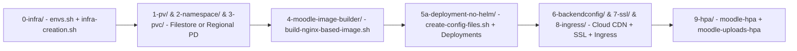

# Moodle on GCP Quickstart & Architectural Map

This repository provides a cloud-native architecture for running **Moodle 5.2.4** (also compatible with Moodle 5.3 and 4.x) on **Google Kubernetes Engine (GKE)** with **Alpine 3.21 + NGINX + PHP 8.3**, **Cloud SQL for MySQL 8.4**, **Memorystore for Redis / Redis Cluster**, selectable storage modalities (**Cloud Filestore** or **Regional Replicated Persistent Disk**), **dedicated upload pods**, and **Google Cloud CDN**.

## End-to-End Deployment Quickstart (Step by Step)

1. **Configure Environment Variables (`0-infra/envs.sh`)**:
   - Populate `PROJECT_NUMBER`, `PROJECT_ID`, `REGION`, `VPC_NAME`, `SUBNET_NAME`, and select `STORAGE_TYPE` (`filestore`, `regional-pd`, or `none`) along with storage capacities (`FILESTORE_TIER`, `FILESTORE_CAPACITY`, `PD_DISK_SIZE`, `PV_STORAGE_SIZE`, `PVC_STORAGE_SIZE`).
2. **Provision Infrastructure (`0-infra/infra-creation.sh`)**:
   - Run `./0-infra/infra-creation.sh` to create the custom VPC, Cloud NAT, private GKE cluster (Standard or Autopilot with Filestore and Persistent Disk CSI drivers), Cloud SQL (`MYSQL_8_4`), Memorystore Redis, Artifact Registry, selected storage, and Jumpbox VM.
3. **Render Kubernetes Manifests (`5a-deployment-no-helm/create-config-files.sh`)**:
   - Run `./5a-deployment-no-helm/create-config-files.sh` to generate parameterized PV, PVC, StorageClass, ConfigMap, and Deployment (primary and uploads) manifests.
4. **Create Namespace, PV, and PVC (`1-pv/`, `2-namespace/`, `3-pvc/`)**:
   - For Filestore: `kubectl apply -f 1-pv/pv-filestore.yaml -f 2-namespace/namespace-moodle.yaml -f 3-pvc/pvc-filestore.yaml`
   - For Regional PD: `kubectl apply -f 1-pv/pv-regional-pd.yaml -f 2-namespace/namespace-moodle.yaml -f 3-pvc/pvc-regional-pd.yaml`
5. **Build the Container Image (`4-moodle-image-builder/build-nginx-based-image.sh`)**:
   - Run `./4-moodle-image-builder/build-nginx-based-image.sh` to compile `preloadable_libiconv.so` and publish the NGINX + PHP 8.3 image to Artifact Registry via Cloud Build.
6. **Deploy Secrets, ConfigMaps, Deployments, and Services (`5a-deployment-no-helm/`)**:
   - Apply `moodle-externaldb-secret.yaml`, `moodle-password-secret.yaml`, `moodle-configmap-nginx.yaml`, `moodle-configmap-nginx-uploads.yaml`, `moodle-deployment-nginx.yaml`, `moodle-deployment-nginx-uploads.yaml`, `moodle-service.yaml`, and `moodle-service-uploads.yaml`.
7. **Configure Cloud CDN, SSL, Ingress, and HPA (`6-backendconfig/`, `7-ssl-certificate-and-redirect/`, `8-ingress/`, `9-hpa/`)**:
   - Apply `6-backendconfig/ingress-backendconfig-nginx.yaml` and `6-backendconfig/ingress-backendconfig-nginx-uploads.yaml`, the certificate/redirect manifests in `7-ssl-certificate-and-redirect/`, the Ingress in `8-ingress/gce-ingress-external.yaml`, and the HPAs in `9-hpa/`.

## OpenWiki Architectural Task-Routing Map

| Goal or Subsystem | Reference OpenWiki Page | Key Repository Files |
| :--- | :--- | :--- |
| **GCP Provisioning, Selective Adoption, and Cloud SQL MySQL 8.4** | [GCP Infrastructure, Selective Adoption, and Cloud SQL MySQL 8.4](/openwiki/architecture/infrastructure-and-networking.md) | `0-infra/envs.sh`, `0-infra/infra-creation.sh`, `0-infra/cleanup-moodle-install.sh`, `0-infra/infra-pause.sh`, `0-infra/infra-resume.sh`, `0-infra/infra-destroy.sh` |
| **Choosing Between Cloud Filestore and Regional Replicated PD (`regional-pd`)** | [Storage Modalities: Filestore vs. Regional Replicated Persistent Disk](/openwiki/architecture/storage-modalities.md) | `1-pv/pv-filestore.yaml`, `1-pv/pv-regional-pd.yaml`, `1-pv/storageclass-regional-pd.yaml`, `3-pvc/pvc-filestore.yaml`, `3-pvc/pvc-regional-pd.yaml` |
| **Alpine 3.21 + PHP 8.3 Container Image, `preloadable_libiconv.so`, and Moodle 5.2+ `/public`** | [NGINX + PHP 8.3 Container Image, GNU libiconv, and Moodle 5.2+ Bootstrap](/openwiki/runtime/container-image-moodle52-php83.md) | `4-moodle-image-builder/Dockerfile.nginx`, `4-moodle-image-builder/scripts/build-gnu-libiconv.sh`, `4-moodle-image-builder/base/opt/setup_moodle.sh`, `4-moodle-image-builder/config.php.template` |
| **GKE Deployments, Upload Pod Isolation, and HPA** | [GKE Deployments, Upload Pod Isolation, and Horizontal Pod Autoscaling](/openwiki/operations/gke-deployments-and-uploads-isolation.md) | `5a-deployment-no-helm/create-config-files.sh`, `5a-deployment-no-helm/moodle-deployment-nginx.yaml`, `5a-deployment-no-helm/moodle-deployment-nginx-uploads.yaml`, `9-hpa/` |
| **Cloud CDN for Moodle, NGINX/PHP-FPM Tuning, and Ingress Routing** | [Cloud CDN for Moodle, NGINX/PHP-FPM Tuning, and Ingress Routing](/openwiki/operations/cloud-cdn-and-ingress.md) | `4-moodle-image-builder/base/etc/nginx/nginx.conf-template`, `6-backendconfig/ingress-backendconfig-nginx.yaml`, `8-ingress/gce-ingress-external.yaml` |
