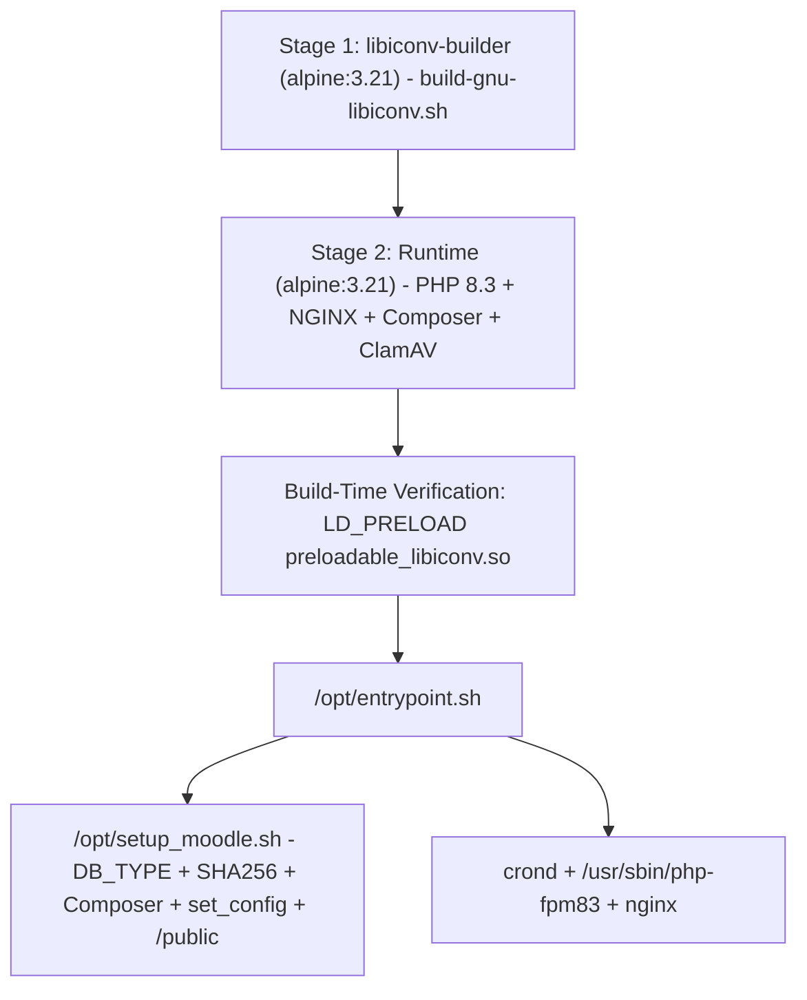

# NGINX + PHP 8.3 Container Image, GNU libiconv, and Moodle 5.2+ Bootstrap

The `4-moodle-image-builder/` directory builds the Moodle container image for GKE on **Alpine Linux 3.21**, **NGINX 1.26**, and **PHP 8.3 (`8.3.36`)**, satisfying all runtime requirements introduced in Moodle 5.0, 5.1, and 5.2.4.

## 1. Multi-Stage `preloadable_libiconv.so` Compilation (MDL-80440)

Alpine Linux's default `musl` libc does not support the `//TRANSLIT` modifier in `iconv()`, which Moodle requires (`MDL-80440`). Instead of pulling legacy packages from `alpine/v3.13` repositories (which break with modern toolchains), `4-moodle-image-builder/Dockerfile.nginx` uses a multi-stage build:

1. **Stage 1 (`libiconv-builder`)**: Runs `4-moodle-image-builder/scripts/build-gnu-libiconv.sh`, which compiles a shared library `/usr/lib/preloadable_libiconv.so` exporting POSIX `iconv_open`, `iconv`, and `iconv_close` symbols linked against Alpine 3.21's `gnu-libiconv-dev` (or compiling official `libiconv-1.18` from source when invoked with `--from-source`).
2. **Stage 2 (Runtime)**: Copies `/usr/lib/preloadable_libiconv.so`, installs `gnu-libiconv-libs` and `icu-data-full`, sets `ENV LD_PRELOAD=/usr/lib/preloadable_libiconv.so`, and validates transliteration at build time (`php -r 'if (iconv("UTF-8", "ASCII//TRANSLIT", "Olá") === false) exit(1);'`).

## 2. PHP 8.3, Conditional `mysqli` vs. `pgsql` Drivers, and Dynamic Composer Verification

`Dockerfile.nginx` installs all `php83-*` packages required by Moodle 5.2.4 (`php83-fpm`, `php83-opcache`, `php83-mysqli`, `php83-pdo_mysql`, `php83-pgsql`, `php83-pdo_pgsql`, `php83-intl`, `php83-soap`, `php83-sodium`, `php83-exif`, `php83-zip`, `php83-gd`, `php83-pecl-redis`, `php83-pecl-igbinary`, `php83-pecl-apcu`, `php83-pecl-zstd`), creates the `/usr/bin/php -> /usr/bin/php83` symlink, and installs Composer after dynamically verifying its SHA-384 signature against `https://composer.github.io/installer.sig`.

At container startup, `4-moodle-image-builder/base/opt/setup_moodle.sh` inspects `DB_TYPE`:
- When `DB_TYPE=pgsql` (Cloud SQL for PostgreSQL / AlloyDB), it enables `00_pdo.ini`, `02_pgsql.ini`, and `02_pdo_pgsql.ini` (removing MySQL `.ini` files), defaults `DB_HOST_PORT` to `5432`, and verifies `php83 -m | grep -qx pgsql`.
- When `DB_TYPE=mysqli` (default), it enables `00_pdo.ini`, `01_mysqlnd.ini`, `02_mysqli.ini`, and `02_pdo_mysql.ini` (removing PostgreSQL `.ini` files), defaults `DB_HOST_PORT` to `3306`, and verifies `php83 -m | grep -qx mysqli`.

## 3. Moodle 5.2.4 Bootstrap, Composer Dependencies, and `/public` Webroot (`setup_moodle.sh`)

`4-moodle-image-builder/base/opt/setup_moodle.sh` orchestrates idempotent Moodle initialization:

1. **Templates and Dynamic Overrides (`envsubst` + `sed -i`)**:
   - Renders `/etc/nginx/nginx.conf` and `/etc/php83/php.ini` via `envsubst` and immediately applies optional environment overrides (`PHP_MEMORY_LIMIT`, `PHP_UPLOAD_MAX_FILESIZE`/`UPLOAD_MAX_FILESIZE`, `PHP_POST_MAX_SIZE`/`POST_MAX_SIZE`, `PHP_MAX_EXECUTION_TIME`, `PHP_MAX_INPUT_TIME`, `NGINX_CLIENT_MAX_BODY_SIZE`/`CLIENT_MAX_BODY_SIZE`, `PHP_FPM_MAX_CHILDREN`).
2. **SHA-256 Integrity Verification (`MOODLE_SHA256` and `MOOSH_SHA256`) and Moodle 5.1+ Composer Dependencies**:
   - Before extracting `/tmp/moodle.tar.gz` and `/tmp/moosh.tar.gz`, `setup_moodle.sh` optionally verifies the SHA-256 hash via `sha256sum -c -` when `MOODLE_SHA256` or `MOOSH_SHA256` is populated in the `ConfigMap`.
   - Starting in Moodle 5.1, the `vendor/` directory is no longer bundled in the GitHub release tarball. `setup_moodle.sh` detects `composer.json` and runs `sudo -u www composer install --no-dev --classmap-authoritative --no-interaction --working-dir="$MOODLE_PATH"` on both fresh installs and upgrades (`.moodle-autoupgrade`), as well as installing Moosh's Composer dependencies.
   - Directory and file permissions are restricted to least privilege using batched execution (`+`): `0755`/`0644` in `$MOODLE_PATH` and `0750`/`0640` in `$MOODLE_DATAROOT_PATH`.
3. **Credential Isolation (`getenv()`), `DB_PERSIST`, and Batched `set_config()`**:
   - Read-replica database configuration (`$CFG->dboptions['readonly']`) reads `DB_READ_REPLICA_HOST`, `DB_READ_REPLICA_PORT`, `DB_READ_REPLICA_USER`, and `DB_READ_REPLICA_PASSWORD` dynamically via `getenv()` in PHP rather than interpolating plaintext passwords via `sed -i`, removing the temporary `config.php.bak` file immediately after splicing. When `DB_PERSIST=true` (e.g. behind ProxySQL), `dbpersist` is enabled in `config.php`.
   - All 13 binary-path and SMTP settings are applied in a single `php83 -r` call using `set_config()`, reading `SMTP_PASSWORD` via `getenv('SMTP_PASSWORD')` without exposing the secret in process listings (`ps`).
4. **Automatic `/public` Webroot Detection (`MDL-83424`) and Port `8080` `publicpaths.php` Check**:
   - In Moodle 5.1+, all web entrypoints moved under `$MOODLE_PATH/public`. `setup_moodle.sh` checks `if [ -d "$MOODLE_PATH/public" ]` and automatically updates the NGINX `root` directive in `/etc/nginx/nginx.conf` to `root ${MOODLE_ROOT_PATH}/moodle/public;`, while rewriting `publicpaths.php` to target `http://localhost:8080` for internal container self-checks.
5. **Moodle 5.0+ Routing Engine (`$CFG->routerconfigured = true`), Redis `igbinary` + `zstd` High-Concurrency Tuning, Moosh 1.51 (`master`), and `local_redislock`**:
   - `4-moodle-image-builder/config.php.template` sets `$CFG->routerconfigured = true;` to enable Moodle's SlimPHP routing engine (`/r.php` for REST API v2 and shimmed controllers), enables `$CFG->session_redis_serializer_use_igbinary = true` and `$CFG->session_redis_compressor = 'zstd'` (~55% smaller session payloads and 4x faster serialization), and checks `is_readable(__DIR__ . '/public/local/redislock/classes/lock/redis_lock_factory.php') || is_readable(__DIR__ . '/local/redislock/classes/lock/redis_lock_factory.php') || class_exists('\\local_redislock\\lock\\redis_lock_factory')` before activating `$CFG->lock_factory`.
